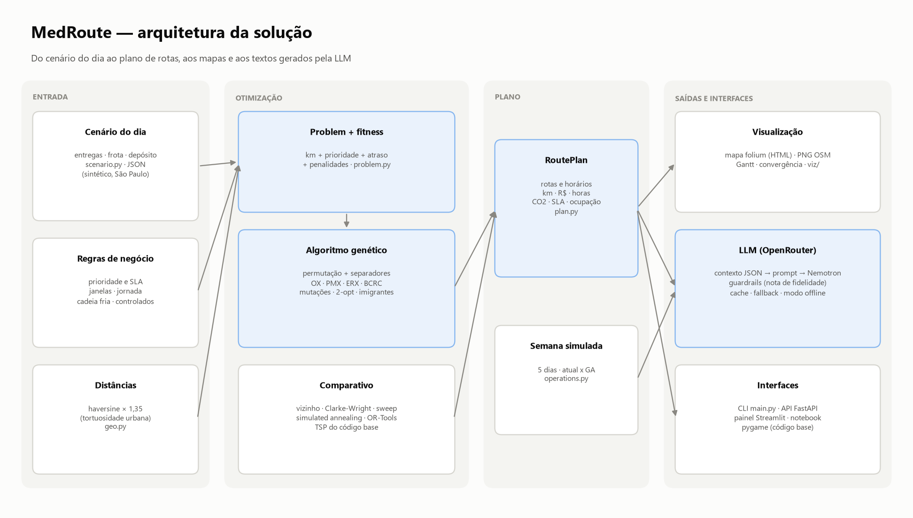

# MedRoute — Tech Challenge Fase 2

## Otimização de rotas para distribuição de medicamentos e insumos (Projeto 2)

O hospital universitário distribui medicamentos e insumos para UBS, UPA, AME, CAPS, Hospital Dia e
pacientes em atendimento domiciliar. O **MedRoute** parte do **código base de TSP** fornecido e o
transforma num **roteamento de veículos (VRP)** resolvido por **algoritmo genético**, com as
restrições reais da operação: prioridade com prazo, capacidade, autonomia, frota heterogênea,
cadeia fria, medicamentos controlados, janelas de recebimento e jornada. Uma **LLM gratuita**
(Nemotron 3 Ultra, via OpenRouter) transforma o plano em instruções para motoristas, relatórios
diários e semanais, sugestões de melhoria e respostas em linguagem natural — e cada resposta é
**auditada automaticamente** contra os dados.

**Aplicação online:** https://187.127.18.205/fase2/ · **Vídeo:** https://youtu.be/w4pS3wKAtDs ·
**Relatório (PDF):** [`Tech_Challenge_Fase2_Entregavel.pdf`](Tech_Challenge_Fase2_Entregavel.pdf)


| Cenário de referência (36 entregas, 5 veículos) | Processo atual | **MedRoute** |
|---|---|---|
| Distância | 299,5 km | **253,5 km** (−15%) |
| Custo do dia | R$ 1.577 | **R$ 1.178** (−25%) |
| Entregas no prazo | 58,3% | **97,2%** |
| Críticas no prazo | 37,5% | **87,5%** |
| Violações de restrições | 0 | **0** |

Semana simulada (170 entregas): **−319 km (−24%)**, **−R$ 1.845**, **−18,8 h**, **−104 kg de CO₂**;
entregas no prazo de **57,6% → 98,8%**. GA: fitness **504,7 ± 4,7** em 10 execuções (a ~1% do melhor
conhecido). LLM: nota média **97,8/100** nos guardrails e **zero erros factuais** na versão final do
prompt.

---

## Entregáveis

| Entregável | Onde |
|---|---|
| Código-fonte completo | [`src/medroute/`](src/medroute/) (+ [`app/`](app/), [`scripts/`](scripts/), [`main.py`](main.py)) |
| **Relatório técnico** | [`docs/RELATORIO_TECNICO.md`](docs/RELATORIO_TECNICO.md) · PDF: [`Tech_Challenge_Fase2_Entregavel.pdf`](Tech_Challenge_Fase2_Entregavel.pdf) |
| Documentação da API | [`docs/API.md`](docs/API.md) · OpenAPI: [`docs/openapi.json`](docs/openapi.json) · Swagger em `/docs` |
| Arquitetura (diagramas) | [`docs/ARQUITETURA.md`](docs/ARQUITETURA.md) · `reports/figures/00*_*.png` |
| Engenharia de prompts e avaliação da LLM | [`docs/PROMPTS.md`](docs/PROMPTS.md) · [`reports/llm/`](reports/llm/) |
| Notebook de demonstração (executado) | [`notebooks/demo_medroute.ipynb`](notebooks/demo_medroute.ipynb) |
| Scripts de demonstração/experimentos | [`main.py`](main.py), [`scripts/run_experiments.py`](scripts/run_experiments.py), [`scripts/avaliar_llm.py`](scripts/avaliar_llm.py) |
| Testes automatizados | [`tests/`](tests/) — `python -m pytest` |
| Vídeo de demonstração (11 min 41 s) | **https://youtu.be/w4pS3wKAtDs** · gerado por [`scripts/video/`](scripts/video/) · roteiro em [`docs/ROTEIRO_VIDEO.md`](docs/ROTEIRO_VIDEO.md) · legendas em [`video/`](video/) |
| Aplicação publicada (painel) | **https://187.127.18.205/fase2/** · implantação em [`HOSTINGER.md`](HOSTINGER.md), [`Dockerfile`](Dockerfile) e [`deploy/`](deploy/) |
| Código base original (referência) | [`legacy/`](legacy/) — com a análise dos problemas encontrados |

---

## Como executar

Requer **Python 3.11**. A partir desta pasta (`fase2/`):

```bash
python -m venv .venv
.venv\Scripts\activate                 # Windows   |   source .venv/bin/activate (Linux/Mac)
pip install -r requirements.txt
pip install -e . --no-deps             # instala o pacote medroute
copy .env.example .env                 # (opcional) coloque sua OPENROUTER_API_KEY
```

> Com **Poetry 2.x**: `poetry install --all-extras` (o `pyproject.toml` é PEP 621).
> Sem chave da OpenRouter tudo funciona: a LLM cai para o **modo offline** (templates).

| O quê | Comando |
|---|---|
| Pipeline completo (cenário → GA → comparativo → mapas → semana → LLM) | `python main.py` |
| Só o GA, com parâmetros | `python main.py otimizar --geracoes 800 --crossover bcrc` |
| Comparar abordagens | `python main.py comparar` |
| Perguntar à LLM | `python main.py llm perguntar "Qual veículo leva a insulina do PD-05?"` |
| Regenerar só os textos da LLM | `python main.py textos` |
| Visualizador ao vivo (pygame, herdado do código base) | `python main.py visualizar` |
| Painel interativo | `streamlit run app/dashboard.py` |
| API REST (docs em http://127.0.0.1:8000/docs) | `uvicorn medroute.api.app:app --reload` |
| Experimentos do relatório (10 sementes, ablação, escala) | `python scripts/run_experiments.py` |
| Avaliar as saídas da LLM | `python scripts/avaliar_llm.py` |
| Testes | `python -m pytest` |
| Notebook (recria e executa) | `python scripts/gerar_notebook.py` |
| Diagramas de arquitetura | `python scripts/gerar_diagramas.py` |
| PDF entregável | `python scripts/gerar_relatorio_pdf.py --repo <url> --video <url> --site <url>` |
| Vídeo (MP4 + SRT) | `python scripts/video/gerar_video.py` |
| Implantar numa VPS Ubuntu 24.04 (como root) | `bash deploy/provision.sh <IP>` — ver [`HOSTINGER.md`](HOSTINGER.md) |

---

## Como funciona

**Representação.** Permutação das N entregas com K−1 separadores; o trecho *k* é a rota do veículo
*k* (com K = 1 é o cromossomo do TSP do código base).

**Fitness (minimizar).** km + peso da prioridade × hora de chegada + peso × minutos de atraso +
penalidades de capacidade, autonomia, compatibilidade (cadeia fria/controlados) e jornada.

**Operadores.** Seleção por torneio (também roleta, ranking, truncamento); crossover OX, PMX, ERX e
**BCRC** (específico de VRP); mutações troca, inversão, inserção, embaralhamento, **prioridade** e
**reparo**; elitismo, anti-duplicata, imigrantes; população inicial semeada por heurísticas; 2-opt
e relocate (memético).

**Comparativo.** Vizinho mais próximo, despachante (processo atual), Clarke & Wright, sweep,
busca local, busca aleatória, **Simulated Annealing**, **Google OR-Tools** e o TSP do código base —
todos com a mesma avaliação.

**LLM.** O otimizador calcula tudo; a LLM só redige a partir de um JSON com os números prontos.
Prompts com papel, regras de aterramento, dados delimitados, esqueleto de saída e exemplo;
simulações "e se" validam as sugestões antes da LLM; guardrails dão nota de fidelidade a cada
resposta; cache, fallback de modelos e modo offline.



---

## Estrutura

```
fase2/
├── main.py                 # CLI e pipeline completo
├── app/dashboard.py        # painel Streamlit
├── src/medroute/
│   ├── domain.py           # entregas, veículos, cenário, prioridades
│   ├── scenario.py         # cenário sintético de São Paulo (reprodutível)
│   ├── geo.py              # haversine + fator de tortuosidade
│   ├── problem.py          # instância compilada + função fitness
│   ├── ga/                 # representação, operadores, busca local, motor
│   ├── baselines.py        # abordagens de comparação (+ OR-Tools, SA)
│   ├── legacy_tsp.py       # GA do código base reproduzido fielmente
│   ├── plan.py             # plano de rotas + KPIs (km, R$, h, CO2, SLA)
│   ├── operations.py       # semana operacional simulada
│   ├── viz/                # mapas folium/PNG, gráficos, pygame
│   ├── llm/                # OpenRouter, contexto, prompts, guardrails, offline
│   └── api/app.py          # API REST (FastAPI)
├── tests/                  # testes automatizados (sem rede)
├── scripts/                # experimentos, avaliação da LLM, diagramas, notebook, PDF, vídeo
├── notebooks/              # demonstração narrada (com saídas)
├── docs/                   # relatório técnico, arquitetura, API, prompts, roteiro do vídeo
├── reports/                # figuras, mapas, CSVs, planos JSON, textos e avaliação da LLM
├── legacy/                 # código base original (CC0) + análise
├── deploy/                 # provisionamento da VPS, nginx, HTTPS, deploy contínuo
├── Dockerfile              # imagem do painel publicado
└── data/cenario_padrao.json
```

---

## Mapa dos requisitos do enunciado

| Requisito (Projeto 2) | Onde |
|---|---|
| TSP/VRP para rotas de medicamentos e insumos | `ga/`, `problem.py` |
| Representação genética adequada | `ga/representation.py` · relatório §3.1 |
| Seleção, crossover e mutação especializados | `ga/operators.py` · relatório §3.3 |
| Fitness com distância, prioridade e restrições | `problem.py` · relatório §3.2 |
| Prioridades (críticos × regulares) | `domain.PriorityPolicy` (peso + prazo) |
| Capacidade de carga | `Vehicle.capacity_kg` + penalidade + reparo |
| Autonomia | `Vehicle.range_km` + penalidade + reparo |
| Múltiplos veículos (VRP) | separadores no cromossomo; frota heterogênea |
| Outras restrições | cadeia fria, controlados, janelas, jornada |
| Partir do código base | `legacy/` + `legacy_tsp.py` + relatório §2 |
| Mapa das rotas | `viz/folium_map.py` (HTML), `viz/static_map.py` (PNG) |
| LLM: instruções para motoristas | `llm/assistant.py::driver_instructions` |
| LLM: relatórios diários/semanais | `daily_report`, `weekly_report` + `operations.py` |
| LLM: sugestões de melhoria | `improvement_suggestions` + `llm/insights.py` (simulações "e se") |
| Prompts eficientes | `llm/prompts.py` · `docs/PROMPTS.md` |
| Perguntas em linguagem natural | `ask` (CLI, painel, API) |
| Projeto Python + ambiente virtual | `pyproject.toml`, `requirements.txt`, `.venv` |
| Documentação + diagramas | `docs/` |
| Testes automatizados | `tests/` |
| Comparativo com outras abordagens | `baselines.py`, `scripts/run_experiments.py` · relatório §6 |
| Visualizações e análises | `reports/figures/`, `reports/maps/` · relatório §5 |
| Vídeo de até 15 min | https://youtu.be/w4pS3wKAtDs (11 min 41 s) |
| Nuvem (opcional) | VPS Hostinger com HTTPS e deploy contínuo · `deploy/`, `HOSTINGER.md` · relatório §8.1 |

---

## Observações do ambiente de desenvolvimento

* **Smart App Control (Windows 11)** bloqueou algumas DLLs/binários recém-baixados. Contornos
  legítimos, sem alterar nenhuma política: `matplotlib` fixado em 3.11.0 (o mesmo da Fase 1) e, no
  vídeo, controle do Microsoft Edge via DevTools Protocol em vez do `selenium-manager.exe`.
* **OpenRouter**: a conta usada só libera provedores NVIDIA/Z-AI, por isso o Nemotron; a cota
  gratuita é de ~50 requisições/dia — daí o cache das respostas (`.cache/llm/`, fora do git) e o modo
  offline. A chave fica só no `.env` local (fora do git).
* Dados **sintéticos**: nenhuma informação real de paciente; bairros e coordenadas aproximadas de
  São Paulo apenas para o mapa fazer sentido.
