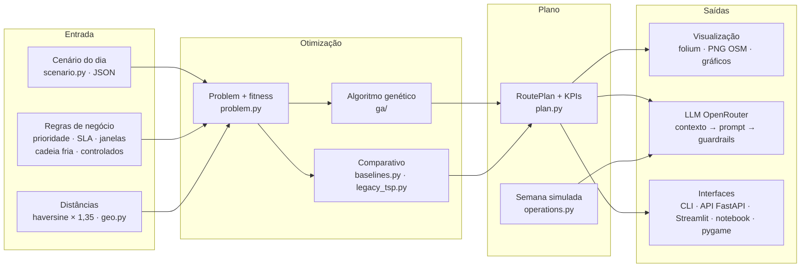
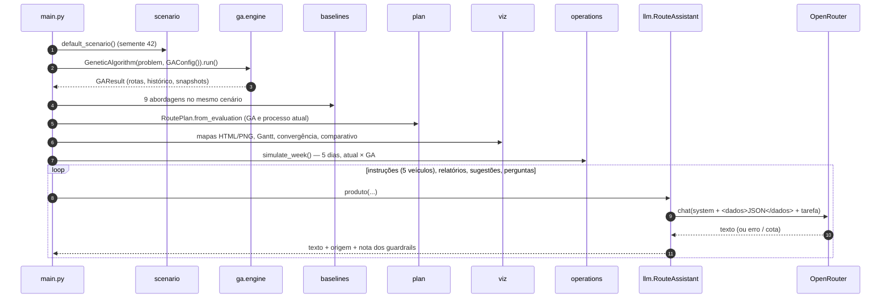
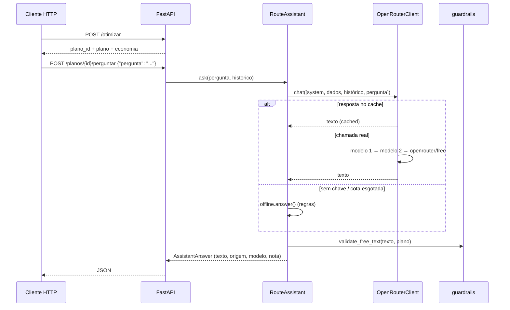
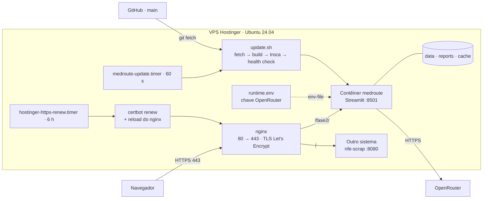

# Arquitetura do MedRoute

> Diagramas em PNG (para o relatório e o vídeo): `reports/figures/00_arquitetura.png`,
> `00b_cromossomo.png`, `00c_ciclo_ga.png`, `00d_fluxo_llm.png`, `00e_implantacao.png` — gerados por
> `python scripts/gerar_diagramas.py`. Abaixo, as mesmas ideias em Mermaid (o
> GitHub renderiza).

## 1. Visão geral

## 2. Módulos (`src/medroute/`)

| Módulo | Responsabilidade |
|---|---|
| `domain.py` | Entidades: `Delivery`, `Vehicle`, `Depot`, `Scenario`, `Priority`, `PriorityPolicy`. Requisitos (`refrigerado`, `controlado`) × recursos do veículo. Serialização JSON. |
| `scenario.py` | Gerador sintético e reprodutível (semente) sobre a geografia de São Paulo; frota padrão; semana de 5 dias; instâncias escaláveis. |
| `geo.py` | Haversine vetorizado e matriz de distâncias com fator de tortuosidade. |
| `problem.py` | Instância compilada (listas/arrays) e **função fitness** — versão rápida (`route_cost`) e detalhada (`evaluate`), testadas para concordar. |
| `ga/representation.py` | Cromossomo = permutação de entregas + separadores de veículo. |
| `ga/operators.py` | Seleção (torneio, roleta, ranking, truncamento), crossover (OX, PMX, ERX, BCRC), mutação (swap, troca vizinha, inversão, inserção, scramble, prioridade, reparo) e inserção mais barata. |
| `ga/local_search.py` | 2-opt, relocate e troca entre rotas (GA memético). |
| `ga/engine.py` | Laço evolutivo, elitismo, anti-duplicata, imigrantes, paciência, limite de tempo, *callback* e *snapshots*. |
| `baselines.py` | Vizinho mais próximo, despachante (processo atual), Clarke & Wright, sweep, busca aleatória, simulated annealing, OR-Tools e TSP do código base fatiado. |
| `legacy_tsp.py` | Reprodução fiel do GA do código base (para comparação e para medir o efeito do bug). |
| `plan.py` | `RoutePlan`: horários de cada parada e KPIs de negócio (km, R$, horas, CO₂, SLA, ocupação); comparação entre planos; exportação. |
| `operations.py` | Semana operacional simulada (processo atual × GA) para o relatório semanal. |
| `viz/` | Mapa interativo (folium), mapa estático com basemap OSM, gráficos de análise e visualizador pygame. |
| `llm/` | Cliente OpenRouter, contexto, prompts, padrões e simulações "e se", guardrails, modo offline e a fachada `RouteAssistant`. |
| `api/app.py` | API REST (FastAPI) com documentação OpenAPI automática. |
| `cli.py` | Linha de comando e pipeline completo (`python main.py`). |

## 3. Pipeline completo (`python main.py`)

## 4. Uma pergunta pela API

## 5. Decisões de arquitetura

| Decisão | Alternativas consideradas | Por quê |
|---|---|---|
| **GA em Python puro** sobre listas | NumPy vetorizado, Numba, DEAP | O gargalo é sequencial (simulação de horários rota a rota); listas nativas foram 3× mais rápidas que indexar arrays NumPy. Sem dependência compilada extra. |
| **Permutação + separadores** | *giant tour* + *split* (Prins), vetor de atribuição | Generaliza o cromossomo do código base (K = 1 vira o TSP), aceita frota heterogênea sem adaptação e todos os operadores de permutação continuam válidos. |
| **Penalidade + operador de reparo** | Só reparo; só penalidade | A penalidade deixa o GA atravessar regiões inviáveis; o reparo dirigido acelera a volta à viabilidade. |
| **Duas implementações da fitness + teste de concordância** | Uma só função | A versão rápida roda ~40 mil vezes por execução; a detalhada alimenta relatórios. O teste garante que nunca divergem. |
| **LLM só redige** (números pré-calculados) | Deixar a LLM calcular | Elimina erro aritmético e permite auditar o texto contra os dados. |
| **Guardrails determinísticos** | Avaliar "no olho"; LLM-juiz | Nota objetiva e reprodutível por resposta, sem gastar cota. |
| **Modo offline** | Falhar sem LLM | O sistema roda sem chave, sem rede e com a cota gratuita esgotada; também serve de linha de base. |
| **Cache em disco das respostas** | Sem cache | Cota gratuita de ~50 requisições/dia; demonstrações reprodutíveis. |
| **Folium (HTML) + PNG com tiles OSM** | Só um dos dois | HTML para explorar (camadas, popups); PNG para relatório e vídeo. |
| **API + painel separados** | Só painel | A API é a integração com outros sistemas do hospital; o painel é a operação do dia a dia. |
| **Planos em memória na API** | Banco de dados | Escopo de demonstração; a troca por Redis/Postgres é local ao `PLANOS`. |
| **VPS + Docker + timer que puxa do GitHub** | PaaS; GitHub Actions empurrando por SSH | Nenhuma credencial do servidor fica no GitHub; a VPS já existia; o custo é até 60 s de atraso entre o commit e a publicação. |

## 6. Como estender

* **Distâncias reais por ruas**: `Problem(scenario, distance_matrix=M)` aceita qualquer matriz (ex.: OSRM ou Google Distance Matrix) — nada mais muda.
* **Nova restrição de compatibilidade** (ex.: "carga perigosa"): basta um novo rótulo em `Delivery.requirements` e `Vehicle.features`.
* **Outro modelo de LLM**: variável `MEDROUTE_LLM_MODELS` (lista separada por vírgulas). Qualquer modelo da OpenRouter funciona; os gratuitos dependem dos provedores liberados na conta.
* **Nova abordagem de comparação**: registrar em `baselines.BASELINES` ou em `run_baseline`.
* **Multi-depósito / múltiplas viagens**: o cromossomo comporta separadores tipados (um por viagem/depósito); a fitness reinicia o relógio a cada retorno.

## 7. Implantação em nuvem

O painel está em **https://187.127.18.205/fase2/**, numa VPS da Hostinger (Ubuntu 24.04). Os
arquivos ficam em [`deploy/`](../deploy/) e a operação em [`HOSTINGER.md`](../HOSTINGER.md).

| Arquivo | Papel |
|---|---|
| `Dockerfile`, `.dockerignore` | imagem só com o painel e o pacote (`pip install -e ".[benchmark]"`), usuário sem privilégio |
| `deploy/cloud-init.yaml` | *user data* da criação da VPS: root só por chave, clona o repositório e chama o `provision.sh` |
| `deploy/provision.sh` | provisiona uma VPS limpa: pacotes, certificado, nginx, renovação e deploy contínuo |
| `deploy/nginx-site.conf` · `deploy/nginx-location.conf` | site completo (TLS + redirecionamento) · só o bloco `/fase2/` |
| `deploy/renew-hostinger-https` + `hostinger-https-renew.{service,timer}` | renovação do certificado a cada 6 h |
| `deploy/setup.sh` | clona o repositório em `/opt/medroute/repo` e liga o timer de atualização |
| `deploy/update.sh` + `medroute-update.{service,timer}` | entrega contínua a cada 60 s, com trava (`flock`) e *health check* |
