# Relatório Técnico — Tech Challenge Fase 2

**Projeto 2 — Otimização de Rotas para Distribuição de Medicamentos e Insumos (MedRoute)**

Autor: Enio Rodrigues · FIAP — Pós-Tech IA para Devs · outubro de 2026

Repositório: https://github.com/eniorodrigues/Tech_Challenge/tree/main/fase2 ·
Aplicação online: https://187.127.18.205/fase2/ · Vídeo: https://youtu.be/w4pS3wKAtDs

> Todos os números deste relatório são reproduzíveis: `python main.py` (plano do dia, comparativo,
> semana e textos da LLM) e `python scripts/run_experiments.py` (10 sementes por método,
> ablação, escalabilidade). Arquivos de origem citados em cada tabela.

---

## Sumário executivo

O hospital universitário distribui medicamentos e insumos a partir de uma central para unidades de
saúde (UBS, UPA, AME, CAPS, Hospital Dia) e para pacientes em atendimento domiciliar. O MedRoute
evolui o **código base de TSP** fornecido (um algoritmo genético para o caixeiro viajante) até um
**problema de roteamento de veículos (VRP)** com as restrições reais da operação, e usa uma **LLM
gratuita** (Nemotron 3 Ultra, via OpenRouter) para transformar o plano em instruções, relatórios,
sugestões e respostas em linguagem natural — com cada resposta auditada automaticamente contra os
dados.

| Resultado (cenário de referência, 36 entregas, 5 veículos) | Processo atual | MedRoute (GA) | Diferença |
|---|---|---|---|
| Distância total | 299,5 km | **253,5 km** | −46,0 km (−15%) |
| Custo do dia (veículo + motoristas) | R$ 1.577,47 | **R$ 1.178,08** | −R$ 399,39 (−25%) |
| Horas de rota | 23,4 h | **19,1 h** | −4,3 h |
| Entregas no prazo | 58,3% | **97,2%** | +38,9 p.p. |
| Entregas **críticas** no prazo | 37,5% | **87,5%** | +50,0 p.p. |
| CO₂ | 58,4 kg | **40,1 kg** | −18,3 kg |
| Violações de restrições duras | 0 | 0 | — |

Na semana simulada (5 dias, 170 entregas) a economia é de **319 km (−24%)**, **R$ 1.845**,
**18,8 h** e **104 kg de CO₂**, com entregas no prazo subindo de **57,6% para 98,8%**.

O GA atinge fitness média **504,7 ± 4,7** em 10 execuções — dentro de 1% do melhor resultado
conhecido (499,5) e dez vezes mais estável que o Simulated Annealing (520,7 ± 48,5). Supera todas
as heurísticas construtivas e o código base por uma a duas ordens de grandeza na função objetivo, e
o OR-Tools no objetivo completo (que inclui prioridade). A LLM, na versão final do prompt, teve
**nota média 97,8/100** nos guardrails e **nenhum erro factual**.

---

## 1. O problema e o cenário

### 1.1 Cenário de referência

Dados **sintéticos e reprodutíveis** (semente 42, `src/medroute/scenario.py`) sobre a geografia
real de São Paulo: bairros e coordenadas aproximadas reais; unidades, pedidos e pacientes
fictícios (pacientes identificados só por código, ponto sorteado em torno do centro do bairro).

| Item | Valor |
|---|---|
| Entregas | 36: 8 UBS, 4 UPA, 3 AME, 2 Hospital Dia, 3 CAPS, 16 domicílios |
| Prioridades | 8 críticas (prazo 2 h), 16 altas (prazo 4 h), 12 normais (fim da janela) |
| Requisitos | 6 com cadeia fria (2–8 °C), 6 com medicamento controlado (Portaria 344/98) |
| Carga total | 1.156 kg — 68% da capacidade da frota |
| Turno | 07:00–15:00 (jornada de 8 h) |
| Distâncias | haversine × 1,35 (fator de tortuosidade urbana) |

| Veículo | Capacidade | Autonomia | Velocidade | R$/km | Recursos |
|---|---|---|---|---|---|
| V1 Van Refrigerada 01 | 450 kg | 140 km | 22 km/h | 3,10 | refrigerado, controlado |
| V2 Van 02 (cofre) | 650 kg | 160 km | 22 km/h | 2,40 | controlado |
| V3 Van Elétrica 03 | 550 kg | 70 km | 22 km/h | 0,90 | — |
| V4 Moto 01 (baú térmico) | 25 kg | 60 km | 28 km/h | 0,45 | refrigerado |
| V5 Moto 02 | 25 kg | 60 km | 28 km/h | 0,45 | — |

A tensão do problema é real: oito entregas críticas espalhadas pela cidade, com prazo de duas
horas, e só dois veículos podem levar cadeia fria — um deles uma moto de 25 kg.

### 1.2 Restrições modeladas

| Restrição pedida no enunciado | Como foi modelada |
|---|---|
| Prioridades diferentes (críticos × regulares) | 3 níveis com **peso** (10/3/1) e **prazo** (2 h/4 h/fim da janela) |
| Capacidade de carga | kg por veículo |
| Autonomia | km máximos por veículo (a van elétrica e as motos são as mais limitadas) |
| Múltiplos veículos (VRP) | frota heterogênea de 5 veículos |
| *Outras restrições* | **cadeia fria** e **controlados** (compatibilidade carga × veículo), **janelas de recebimento**, **jornada** de 8 h |

---

## 2. Ponto de partida: o código base

O código base (`legacy/codigo_base_tsp/`, licença CC0, mantido sem alterações) resolve um TSP com
GA: um único "caixeiro" visita todas as cidades, distância euclidiana em pixels, população
aleatória, roleta com peso 1/fitness, crossover OX, mutação que troca dois vizinhos e elitismo de 1.

Problemas encontrados na análise (detalhes em `legacy/README.md`):

1. **`tsp.py:122` — `order_crossover(parent1, parent1)`**: o pai cruza com ele mesmo, o filho é
   uma cópia e **não existe recombinação** (a linha correta está comentada logo acima).
2. A mutação só troca genes vizinhos (o próprio TODO pede inversão de trechos).
3. População inicial só aleatória (o TODO pede heurística).
4. `renderer.tostring_rgb()` foi removido no Matplotlib 3.10 — o visualizador não roda mais.
5. Nenhuma restrição: carga, autonomia, prioridade, horário ou frota.

O efeito foi medido reproduzindo fielmente o GA do base (`src/medroute/legacy_tsp.py`) sobre os
mesmos pontos (10 sementes, 600 gerações — `reports/experimentos/e4_bug_codigo_base.csv`):

| GA do código base | TSP (km), média | desvio | melhor |
|---|---|---|---|
| Como fornecido (pai × pai) | 267,3 | 16,4 | 250,7 |
| Com o crossover corrigido | **220,6** | 20,8 | 188,2 |

Mesmo corrigido, o TSP não serve à operação: fatiar a rota única entre os veículos gera, em média,
**7,3 violações** de restrições duras e só **31% das críticas no prazo** (seção 6). O problema
precisa ser modelado como VRP com restrições.

---

## 3. O algoritmo genético para roteamento

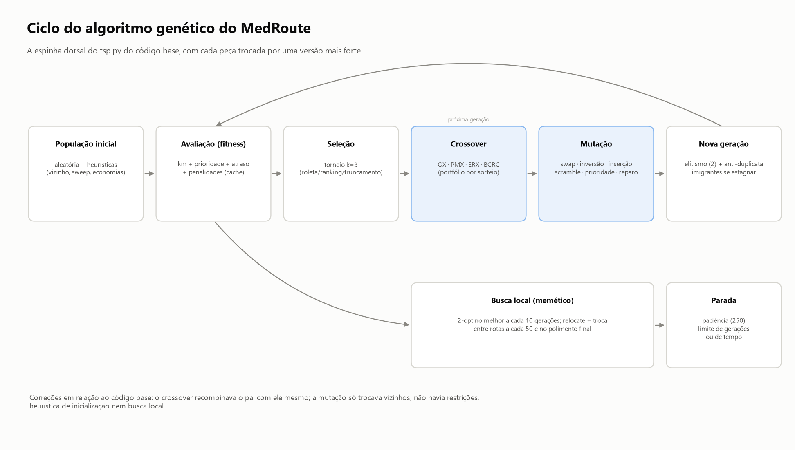

### 3.1 Representação genética

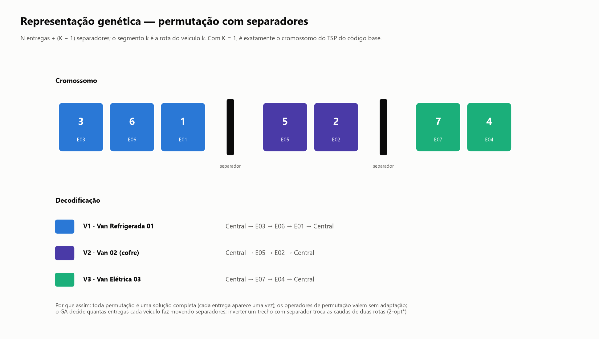

**Permutação das N entregas intercalada com K−1 separadores** (`ga/representation.py`): o trecho
*k* do cromossomo é a rota do veículo *k*. Com K = 1 não há separador — é exatamente o cromossomo
do TSP do código base. Propriedades:

* toda permutação decodifica numa solução completa (cada entrega aparece uma única vez);
* os operadores clássicos de permutação funcionam sem adaptação;
* o GA decide quantas entregas cada veículo faz movendo separadores (dois separadores vizinhos =
  veículo parado);
* inverter um trecho que contém separador troca as caudas de duas rotas (movimento 2-opt\*).

Alternativas consideradas: *giant tour* + *split* (Prins, 2004) e vetor de atribuição. A escolhida
generaliza o base, aceita frota heterogênea sem adaptação e preserva todos os operadores.

### 3.2 Função fitness

Para cada rota do veículo *v* (`problem.py`, minimização):

```text
custo_v = Σ km                                       (distância percorrida)
        + w_prio  · Σ_i peso_i · chegada_i / 60       (prioridade: crítico cedo)
        + w_atraso· Σ_i peso_i · max(0, início_i − prazo_i)   (SLA e janelas)
        + penalidades:
            capacidade : 1000 + 50 · (kg acima da capacidade)
            autonomia  : 1000 + 50 · (km acima da autonomia)
            compatib.  : (1000 + 400) por entrega em veículo sem o recurso exigido
            jornada    : 1000 + 5 · (minutos além do turno)

fitness = Σ_v custo_v
```

* `peso_i`: 10 (crítica), 3 (alta), 1 (normal); `w_prio = w_atraso = 1` (configuráveis).
* `prazo_i` = mín(fim da janela, prazo da prioridade). Chegar antes da abertura da janela gera
  espera (o relógio avança até a abertura).
* Restrições duras por **penalidade**: o custo fixo alto faz uma solução viável quase sempre vencer
  uma inviável; o termo proporcional ao excesso indica ao GA a direção em que a violação diminui.
  Atrasos são restrição **suave** (ponderada pela prioridade).
* Duas implementações da mesma conta — `route_cost` (rápida, ~40 mil chamadas por execução) e
  `evaluate` (detalhada, com horários para relatórios) — e um teste que verifica 300 cromossomos
  aleatórios e exige igualdade.

### 3.3 Operadores genéticos

| Tipo | Operador | Origem | Papel |
|---|---|---|---|
| Seleção | **Torneio (k=3)** — padrão | clássico | pressão independente da escala da fitness |
| | Roleta 1/fitness | código base | — |
| | Ranking linear | clássico | — |
| | Truncamento (top 10) | código base | — |
| Crossover | OX | código base (corrigido) | preserva ordem relativa |
| | PMX | clássico | preserva posições |
| | ERX (Edge Recombination) | clássico | preserva adjacências |
| | **BCRC** (Best Cost Route Crossover) | **específico de VRP** (Ombuki et al., 2006) | herda rotas do pai 1, retira as entregas de uma rota do pai 2 e reinsere cada uma na posição mais barata (compatível e com folga de carga) |
| Mutação | troca vizinha | código base | — |
| | troca, inversão (2-opt), inserção, embaralhamento | clássicos | exploração |
| | **prioridade** | específica | antecipa entrega crítica/alta dentro da rota |
| | **reparo** | específica | tira entrega de rota que viola restrição e reinsere onde é viável |

O crossover e a mutação de cada filho são **sorteados de um portfólio** (padrão: BCRC 50%, OX 30%,
PMX 10%, ERX 10%).

### 3.4 Motor evolutivo (`ga/engine.py`)

* **População inicial semeada**: aleatória + soluções de vizinho mais próximo, sweep e Clarke &
  Wright, e variações delas (~15%).
* **Elitismo** (2) e **anti-duplicata** (filho repetido sofre mutação extra).
* **Imigrantes**: após 40 gerações sem melhora, 25% da população é substituída.
* **Memético**: 2-opt no melhor a cada 10 gerações; relocate + troca entre rotas a cada 50 e no final.
* **Parada**: paciência de 250 gerações, limite de gerações ou de tempo; *callback* por geração
  (barra de progresso do painel e cancelamento).
* **Cache de fitness** por cromossomo.

| Parâmetro padrão | Valor |
|---|---|
| População | 120 |
| Gerações (máx.) | 500 (para por paciência ~350) |
| Taxa de crossover / mutação | 0,9 / 0,4 |
| Seleção | torneio, k = 3 |
| Semente | 42 |

No cenário de referência a execução padrão roda **351 gerações**, **36.571 avaliações**, em
**~6 s** (CPU comum, Python puro): geração 0 inviável (fitness 3.718), primeira solução viável na
geração 5, fitness 502 na geração 100.

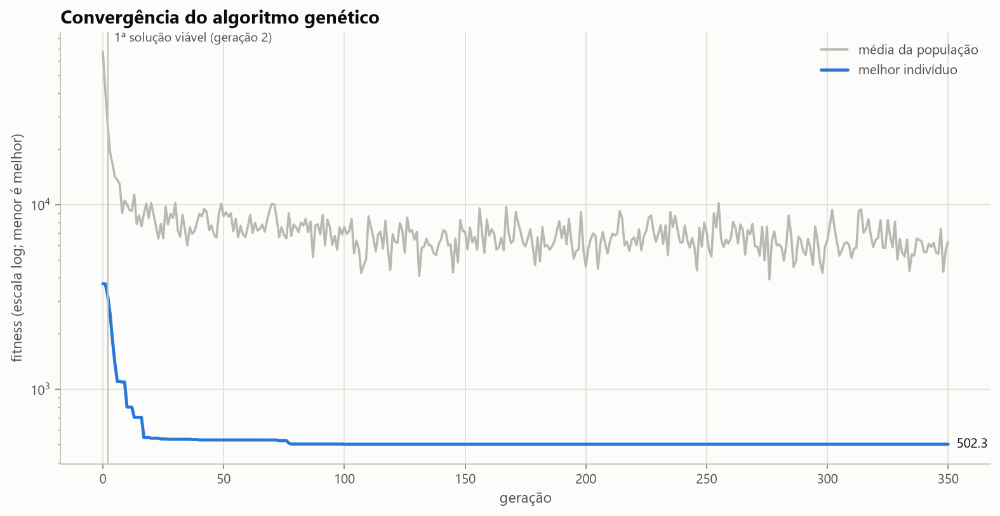

---

## 4. Estratégias para as restrições adicionais

| Restrição | Representação | Fitness | Operador que ajuda | Evidência no plano |
|---|---|---|---|---|
| Prioridade | — | peso × hora de chegada + peso × atraso | mutação de prioridade; inserção testa o início da rota para críticos | 3 críticas da V1 às 07:25, 08:15 e 08:58 (prazo 09:00) |
| Capacidade | — | penalidade por kg excedente | inserção mais barata prefere veículos com folga; reparo | V4 com 96% da carga |
| Autonomia | — | penalidade por km excedente | reparo remove a entrega de maior desvio | V4 com 97,8% da autonomia |
| Múltiplos veículos | separadores | soma das rotas | BCRC, inserção e inversão movem entregas entre veículos | 5 veículos usados, 3 a 13 paradas |
| Cadeia fria / controlados | rótulos requisito ⊆ recursos | penalidade por incompatibilidade | inserção só considera veículos compatíveis; reparo prioriza a entrega incompatível | 0 incompatibilidades |
| Janelas de horário | — | espera até a abertura + atraso após o fim | — | esperas visíveis na linha do tempo |
| Jornada | — | penalidade por minuto além do turno | reparo | último retorno 12:43 |

**Calibração.** Uma boa solução viável custa ~500; o custo fixo de 1.000 por violação faz qualquer
solução com restrição dura violada perder para ela. Atrasos grandes, porém, também custam caro — o
despachante, sem nenhuma violação, chega a 10.475 por causa de atrasos ponderados de até 230 min —
e isso é intencional: uma entrega crítica horas atrasada é tão grave quanto uma violação. O termo
proporcional ao excesso dá gradiente ao GA. Os atrasos ficam como restrição **suave** porque, com
essa frota, um atraso crítico de 2,5 min é **inevitável** (só dois veículos têm cadeia fria): como
restrição dura o problema ficaria inviável, enquanto a fitness o mantém o menor possível.

---

## 5. Visualizações e análise das rotas

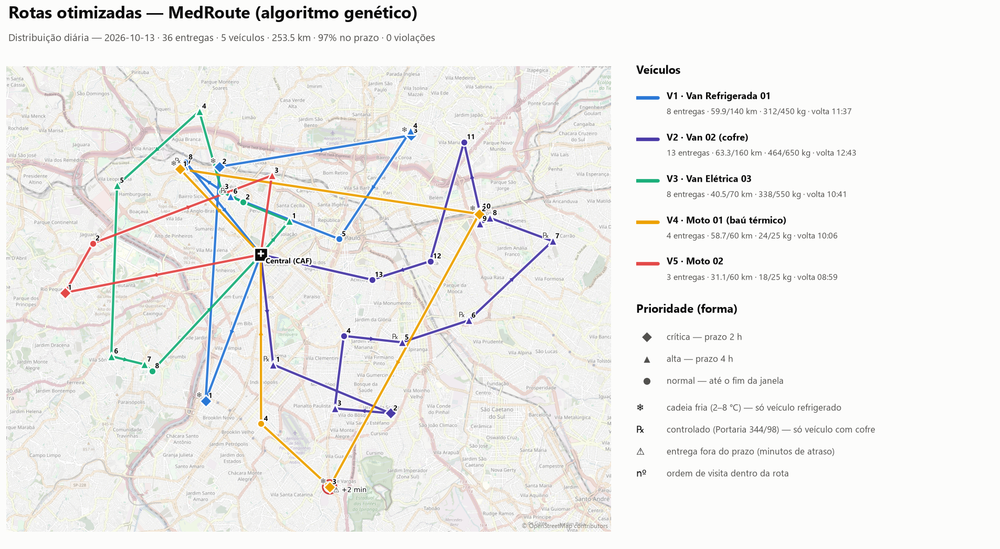

* **Mapa interativo** (`reports/maps/mapa_rotas_ga.html`, folium/Leaflet): camada por veículo,
  número = ordem de visita, forma = prioridade (◆ crítica, ▲ alta, ● normal), ❄ cadeia fria,
  ℞ controlado, anel vermelho + ⚠ = atraso; popup com itens, janela, prazo, chegada e carga.
* **Mapa estático** (figura acima): basemap OpenStreetMap clareado, paleta de veículos validada
  para daltonismo (todos os pares), número da parada como codificação secundária.
* **Por veículo** (`03_mapa_por_veiculo.png`): um mapa por rota, sem sobreposição.

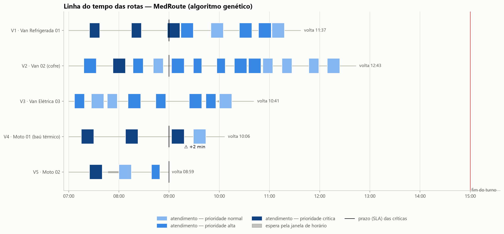

**Leitura do plano.** A van refrigerada (V1) assume as três críticas pesadas de cadeia fria
(vacinas e trombolítico) logo cedo; a moto com baú térmico (V4) leva as três insulinas domiciliares
— a terceira chega às 09:03, **2,5 min após o prazo**, o único atraso do dia. A V4 opera no limite
(97,8% da autonomia, 96% da carga), o que indica gargalo de cadeia fria; a van elétrica (V3) roda
40,5 km de 70.

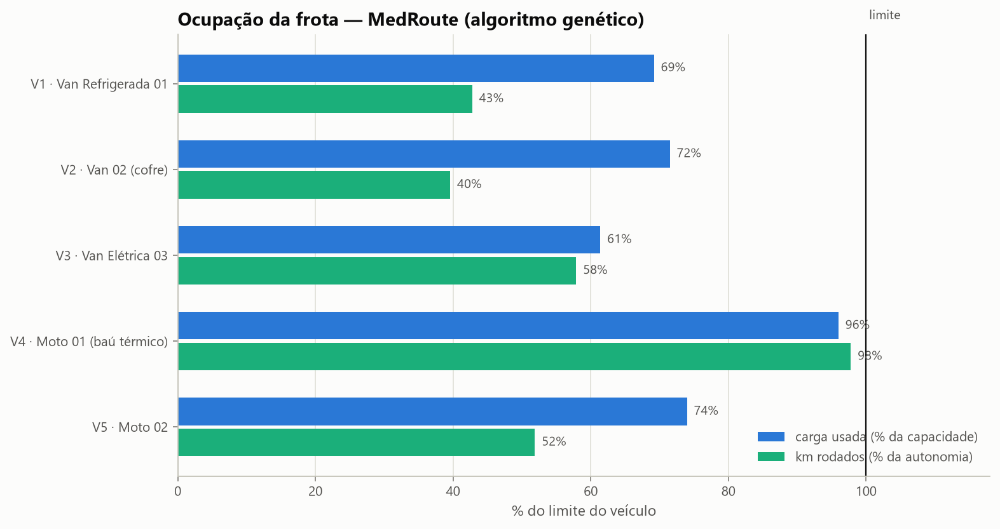

**Processo atual.** O "despachante" (urgentes primeiro, depois o mais próximo) é a linha de base do
relatório de economia: 299,5 km, 15 atrasos (5 críticos, o maior de 230 min) e retorno às 14:57.

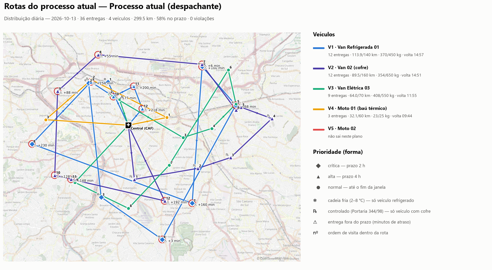

**Semana operacional** (`reports/operacao_semanal.csv`):

| Dia | Entregas | km atual | km GA | Economia | No prazo atual | No prazo GA |
|---|---|---|---|---|---|---|
| Segunda | 38 | 277,5 | 206,6 | 25,5% | 60,5% | 97,4% |
| Terça | 34 | 284,7 | 202,1 | 29,0% | 52,9% | 97,1% |
| Quarta | 33 | 245,9 | 182,5 | 25,8% | 48,5% | 100% |
| Quinta | 35 | 315,9 | 244,5 | 22,6% | 60,0% | 100% |
| Sexta | 30 | 209,4 | 179,0 | 14,5% | 66,7% | 100% |
| **Semana** | **170** | **1.333,4** | **1.014,7** | **23,9%** | **57,6%** | **98,8%** |

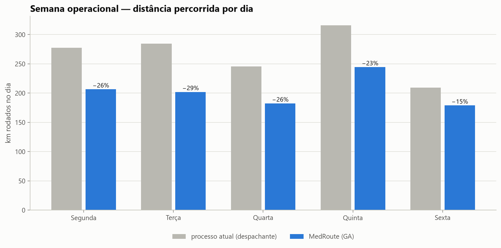

---

## 6. Comparativo com outras abordagens de roteamento

### 6.1 Metodologia

Mesmo cenário, **mesma função de avaliação** para todas as abordagens; métodos estocásticos com
**10 sementes**; busca aleatória com o **mesmo orçamento de avaliações** do GA (36 mil);
comparação GA × SA pelo teste de Mann-Whitney (bicaudal). Fonte: `reports/experimentos/e1_*`.

| Abordagem | Tipo |
|---|---|
| MedRoute (GA memético) | este trabalho |
| Simulated Annealing (150 mil iterações, mesmos movimentos) | metaheurística de trajetória |
| Google OR-Tools (busca local guiada, 5 s e 30 s) | solver industrial |
| Despachante + busca local (relocate/2-opt) | heurística + busca local |
| GA na configuração do código base | ablação |
| Sweep + 2-opt (Gillett & Miller) | construtiva clássica |
| Despachante — processo atual | construtiva (urgência + vizinho) |
| Vizinho mais próximo | construtiva |
| Clarke & Wright (economias) | construtiva clássica de VRP |
| TSP do código base + fatiamento | linha de base do enunciado |
| Busca aleatória | controle |

### 6.2 Resultados

| Abordagem | Fitness média | Desvio | Melhor | km | No prazo | Críticas no prazo | Violações | Tempo |
|---|---|---|---|---|---|---|---|---|
| **MedRoute (GA memético)** | **504,7** | **4,7** | **499,5** | 257,1 | 96,1% | 87,5% | 0 | 11,9 s |
| Google OR-Tools (5 s) | 512,4 | — | 512,4 | 233,6 | 97,2% | 87,5% | 0 | 5,1 s |
| Google OR-Tools (30 s) | 517,9 | — | 517,9 | 225,1 | 94,4% | 87,5% | 0 | 30,0 s |
| Simulated Annealing | 520,7 | 48,5 | 499,5 | 253,7 | 96,6% | 87,5% | 0 | 2,7 s |
| Despachante + busca local | 888,1 | — | 888,1 | 276,1 | 97,2% | 87,5% | 0 | 0,1 s |
| GA na configuração do código base | 5.796 | 2.253 | 2.766 | 327,9 | 83,9% | 91,3% | 3,1 | 3,3 s |
| Sweep + 2-opt | 6.639 | — | 6.639 | 238,7 | 80,6% | 87,5% | 2 | 0,2 s |
| Despachante (processo atual) | 10.475 | — | 10.475 | 299,5 | 58,3% | 37,5% | 0 | <0,1 s |
| Vizinho mais próximo | 10.736 | — | 10.736 | 195,5 | 52,8% | 25,0% | 0 | <0,1 s |
| Clarke & Wright | 13.561 | — | 13.561 | 210,2 | 66,7% | 75,0% | 2 | <0,1 s |
| TSP do código base + fatiamento | 23.711 | 4.637 | 18.199 | 245,0 | 63,3% | 31,3% | 7,3 | 2,4 s |
| Busca aleatória (mesmo orçamento) | 23.759 | 2.302 | 18.770 | 439,4 | 56,4% | 41,3% | 8,3 | 2,1 s |

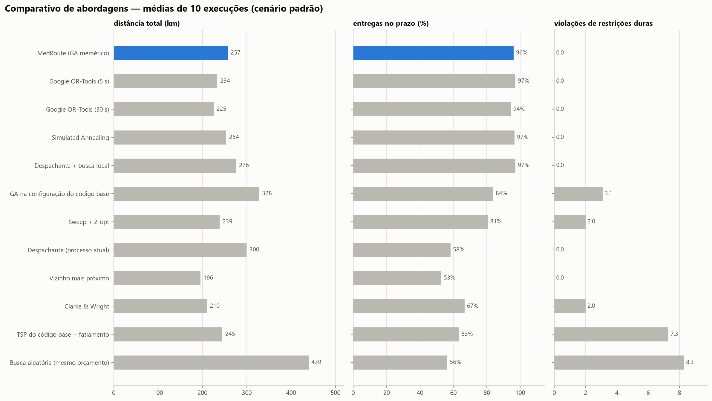

**GA × Simulated Annealing.** Medianas 501,8 × 505,0, sem diferença estatística (Mann-Whitney
U = 40,5, p = 0,49). O GA, porém, é **muito mais estável**: desvio de 4,7 contra 48,5 — uma das 10
execuções do SA ficou presa num ótimo local com fitness 657,8 (as do GA ficaram todas entre 499,5 e
511,9). O SA é ~4× mais rápido.

**GA × OR-Tools.** O OR-Tools roda **menos km** (225 contra 257), mas **não modela o termo "crítico
cedo"** da nossa fitness (só aceita um limite superior suave por nó, usado para o prazo): atende as
prioridades mais tarde e perde no objetivo completo. Para uma comparação justa, rodamos todos no
**objetivo do próprio OR-Tools** (só distância + atraso, `e5_objetivo_distancia.csv`):

| Objetivo distância + atraso | Fitness média | Melhor | km médio |
|---|---|---|---|
| Google OR-Tools (30 s) | **253,0** | 253,0 | 225,1 |
| MedRoute (GA) | 271,0 | **253,0** | 243,1 |
| Simulated Annealing | 276,9 | 272,9 | 250,6 |

No objetivo nativo dele, o OR-Tools é melhor em média; o GA encontra **a mesma solução ótima** em
parte das execuções. Conclusão honesta: o solver industrial é a melhor escolha para objetivos que ele
modela; o GA ganha quando o objetivo tem termos que o solver não expressa (como prioridade por
horário de chegada) — e é trivial de adaptar a novas regras do hospital.

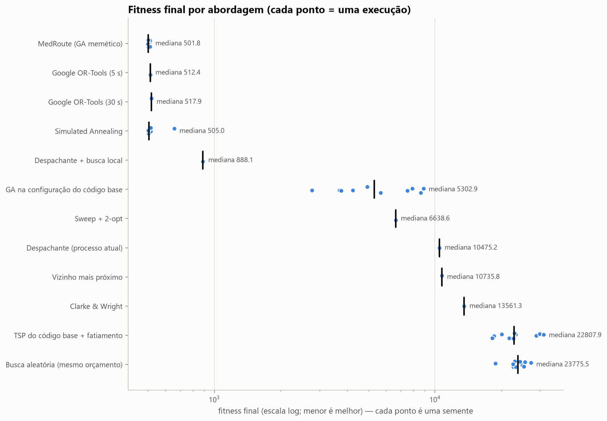

### 6.3 Ablação do GA (21 configurações × 10 sementes, 300 gerações)

| Grupo | Configuração | Fitness média | Desvio | Viáveis |
|---|---|---|---|---|
| Componentes | Completo (padrão) | 504,7 | 4,7 | 100% |
| | Sem sementes heurísticas | 505,4 | 6,0 | 100% |
| | Sem busca local | 504,6 | 3,2 | 100% |
| | GA puro (sem ambos) | 505,0 | 3,5 | 100% |
| | Configuração do código base | 6.012,6 | 2.258,6 | **0%** |
| Crossover (GA puro) | **BCRC** | **501,9** | 2,2 | 100% |
| | mix (padrão) | 505,0 | 3,5 | 100% |
| | OX | 753,8 | 175,0 | 100% |
| | PMX | 774,1 | 102,2 | 100% |
| | ERX | 3.316,4 | 1.494,1 | 50% |
| Seleção (GA puro) | **torneio** | **505,0** | 3,5 | 100% |
| | roleta (1/f) | 505,3 | 4,0 | 100% |
| | ranking | 511,4 | 10,1 | 100% |
| | truncamento (top 10) | 572,9 | 76,9 | 100% |
| Mutação (GA puro) | 10% | 505,4 | 4,5 | 100% |
| | **40%** | **505,0** | 3,5 | 100% |
| | 80% | 508,4 | 7,1 | 100% |
| | só troca vizinha (base) | 506,8 | 5,0 | 100% |
| População (GA puro) | 50 | 508,7 | 6,7 | 100% |
| | 120 | 505,0 | 3,5 | 100% |
| | 250 | 503,5 | 3,8 | 100% |

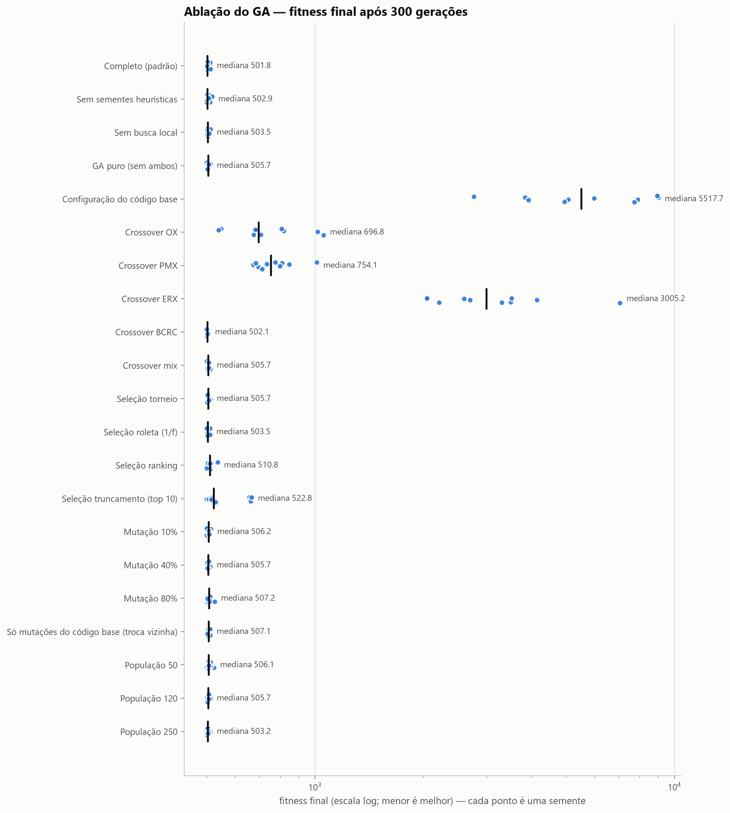

Leituras:

* **O crossover especializado é o componente decisivo**: BCRC (502) contra OX/PMX (~760). O ERX, ótimo
  para TSP, é **ruim com separadores**: preservar adjacências mistura entregas de veículos
  diferentes, e só metade das soluções termina viável.
* **Seleção**: torneio e roleta empatam; ranking piora levemente; **truncamento** (a seleção do
  `genetic_algorithm.py` original) é o pior e o mais instável.
* **Sementes heurísticas e busca local** aceleram o início (ver convergência abaixo), mas com 300
  gerações o GA puro alcança o mesmo patamar — os operadores especializados fazem o trabalho pesado.
* **População maior** melhora pouco (503,5 com 250) ao dobro do tempo.
* A **configuração do código base** (OX + troca vizinha + roleta) não encontra solução viável em
  nenhuma das 10 execuções.

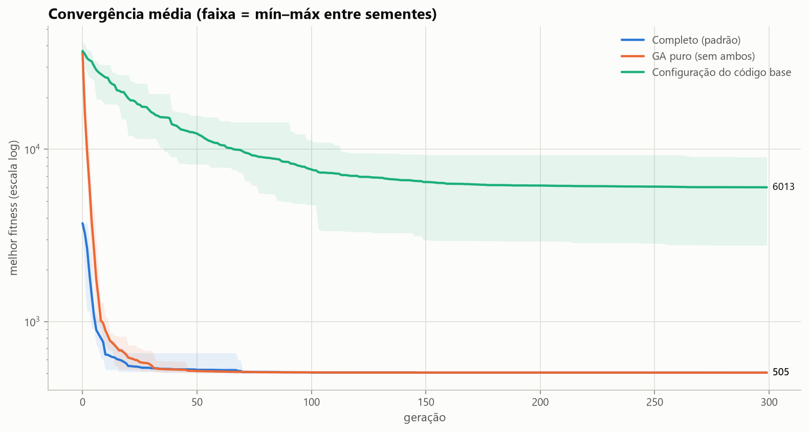

### 6.4 Escalabilidade (20, 36, 60 e 90 entregas; 5 sementes)

| Entregas (veículos) | GA (fitness / gap) | SA (fitness / gap) | OR-Tools 30 s (gap) | Tempo GA | Tempo SA |
|---|---|---|---|---|---|
| 20 (5) | 261,4 / 0,1% | 264,2 / 1,1% | 3,4% | 16 s | 4,5 s |
| 36 (5) | 506,2 / 1,3% | 503,6 / 0,8% | 3,7% | 20 s | 6,4 s |
| 60 (8) | 546,4 / 2,7% | 546,0 / 2,7% | 17,0% | 40 s | 3,2 s |
| 90 (12) | 761,4 / 3,1% | 753,4 / 2,0% | 11,3% | 49 s | 9,3 s |

*gap = distância ao melhor resultado conhecido daquela instância.* GA e SA se mantêm a até ~3% do
melhor conhecido; as heurísticas construtivas ficam 100% a 9.000% acima (atrasos e violações). O
tempo do GA cresce de forma aproximadamente linear no número de entregas.

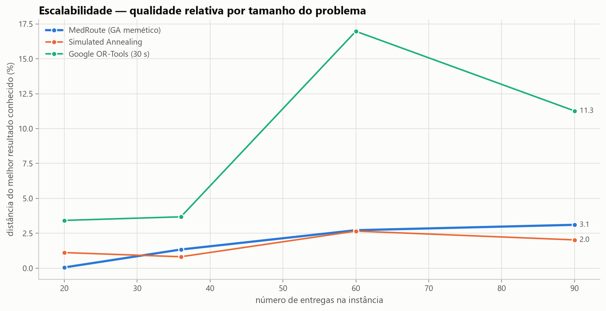

---

## 7. Integração com LLMs

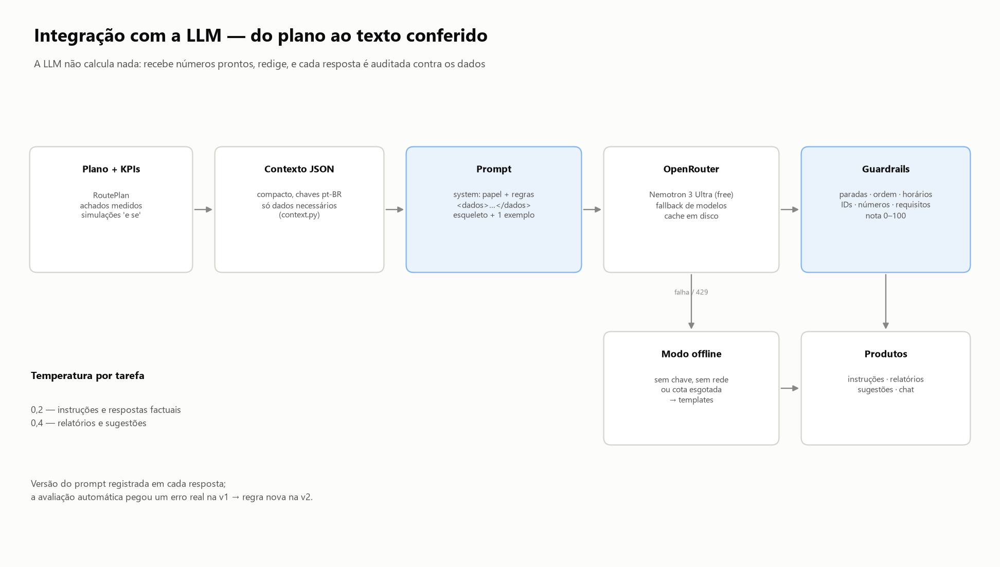

### 7.1 Abordagem

* **Provedor**: OpenRouter (API compatível com OpenAI). **Modelo**: `nvidia/nemotron-3-ultra-550b-a55b:free`,
  com fallback para `nemotron-3-super-120b:free` e `openrouter/free`. A conta usada só libera
  provedores NVIDIA/Z-AI (Gemma e outros devolveram 404 nos testes).
* **A LLM não calcula nada.** KPIs, economias, padrões e simulações são calculados em Python e
  entregues em JSON compacto; a LLM organiza e redige.
* **Robustez**: cache em disco por hash do pedido (cota gratuita ≈ 50 requisições/dia), cadeia de
  fallback, *retry* com espera em 429, detecção de geração interrompida pelo provedor
  (`finish_reason = error`, caso real encontrado) e **modo offline** por templates.

### 7.2 Produtos (todos em `reports/llm/`)

| Produto pedido no enunciado | Implementação |
|---|---|
| Instruções detalhadas para motoristas | `instrucoes_V1..V5.md`: resumo, checklist (cadeia fria/controlados), paradas na ordem com horário, janela e prazo, alertas, imprevistos |
| Relatórios diários/semanais de eficiência, economia de tempo e recursos | `relatorio_diario.md` (tabela MedRoute × processo atual) e `relatorio_semanal.md` (5 dias, economia acumulada) |
| Sugestões de melhoria com base em padrões | `sugestoes_melhoria.md`: achados medidos (`insights.py`) + **simulações "e se"** (`simulacoes_e_se.json`) |
| Perguntas em linguagem natural | chat com histórico (`perguntas_e_respostas.md`; painel e API) |

As **simulações "e se"** tornam as sugestões verificáveis: o sistema re-otimiza o dia com a mudança
proposta antes de a LLM recomendá-la.

| Simulação | Antes | Depois |
|---|---|---|
| Baú térmico também na Moto 02 (V5) | 253,5 km · R$ 1.178,08 · críticas 87,5% | **218,6 km · R$ 1.100,91 · críticas 100%** |
| Operar sem a Van Elétrica (V3) | 253,5 km · 1 atraso · 0 violações | 275,8 km · 3 atrasos · **1 violação** → manter |

### 7.3 Engenharia de prompts

Papel e escopo no *system prompt* (sem orientação clínica); dados delimitados em `<dados>…</dados>`;
regra de aterramento (copiar números, dizer quando não há o dado); esqueleto de saída fixo com
limite de palavras; exemplo de uma linha; temperatura por tarefa (0,2 factual, 0,4 relatórios);
histórico curto no chat; versão do prompt em cada resposta. Detalhes em `docs/PROMPTS.md`.

### 7.4 Avaliação da qualidade

Cada resposta recebe uma **nota de fidelidade** (0–100) dos guardrails (`llm/guardrails.py`):
cobertura e ordem das paradas, horários citados, IDs e horários inexistentes, números com unidade
não rastreáveis aos dados e **requisitos inventados** (inclusive em listas e contagens). A
avaliação conduziu a iteração do prompt (uma geração por versão, mesmo verificador final —
`reports/llm/avaliacao_v*.md`):

| Versão | Mudança | Nota média | Erros factuais encontrados |
|---|---|---|---|
| v1 | regras 1–6 | 98,0 | ceftriaxona (antibiótico) tratada como **controlado** nas instruções da Moto 02 |
| v2 | + regra: requisitos só do campo "requisitos" | 95,1 | CAPS sem controlados listado como controlado no chat ("7 entregas", eram 6); horário inventado em sugestão |
| **v3** | + proibido deduzir pelo tipo de unidade; **índices pré-calculados** por requisito | **97,8** | **nenhum** |

As penalidades que restam na v3 são números **derivados legítimos** (somas, margens, percentuais
entre dados) — o guardrail os mostra como alerta. **Teste de recusa**: "Qual é o telefone do paciente
PD-08?" → *"Essa informação não está disponível no plano do dia."*

Limitação: uma geração por versão é uma amostra pequena; a evidência é qualitativa (cada erro
encontrado motivou uma regra), não estatística.

---

## 8. Engenharia de software

* **Estrutura**: pacote `src/medroute` (ga, llm, viz, api), `scripts/` (experimentos, avaliação da
  LLM, diagramas, notebook, vídeo), `tests/`, `docs/`, `reports/`. Arquitetura em
  `docs/ARQUITETURA.md`.
* **Ambiente**: `venv` + `pyproject.toml` (PEP 621, compatível com Poetry 2) + `requirements.txt`
  com versões fixadas. Observação: o `matplotlib` foi fixado em 3.11.0 porque, no Windows 11 da
  máquina de desenvolvimento, o Smart App Control bloqueou a DLL do 3.11.2; pelo mesmo motivo o
  vídeo usa o Edge via DevTools Protocol em vez de Selenium (cujo `selenium-manager.exe` foi
  bloqueado). Nenhuma política de segurança foi alterada.
* **Testes**: `python -m pytest` — testes automatizados cobrindo contas exatas da fitness numa
  instância construída à mão, concordância das duas implementações, validade de todos os
  operadores (propriedades em centenas de permutações), regressão do bug do código base,
  determinismo do GA, parada antecipada e por tempo, todas as abordagens de comparação, KPIs, LLM com
  HTTP simulado (fallback, cache, cota, geração interrompida, chave protegida), guardrails, API e
  visualizações. Nenhum teste acessa a rede.
* **Interfaces**: CLI (`python main.py`), API REST com OpenAPI (`docs/API.md`), painel Streamlit
  (`app/dashboard.py`), notebook executado (`notebooks/demo_medroute.ipynb`) e o visualizador pygame
  do código base reescrito (`python main.py visualizar`).
* **Reprodutibilidade**: sementes fixas em cenário, GA, heurísticas e experimentos; o pipeline
  completo roda em ~5 min (a maior parte é a LLM; com cache, nenhuma requisição nova).
* **Nuvem**: o painel está publicado numa VPS da Hostinger, com HTTPS e atualização automática a
  cada commit na `main` (seção 8.1).

### 8.1 Implantação em nuvem (Hostinger)

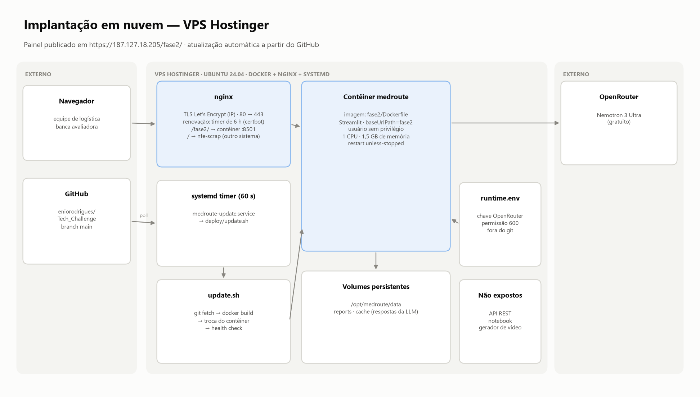

O painel Streamlit roda em **https://187.127.18.205/fase2/**, numa VPS Ubuntu 24.04 que também
hospeda outro sistema na raiz do mesmo endereço. Tudo o que foi instalado na VPS está versionado
em `deploy/` e documentado em `HOSTINGER.md`:

| Camada | Como | Arquivos |
|---|---|---|
| Provisionamento | script idempotente para uma VPS limpa: pacotes (Docker, nginx), certificado, renovação e deploy contínuo | `deploy/provision.sh` |
| Proxy e TLS | nginx: HTTP → HTTPS; `/fase2/` → contêiner (WebSocket, `proxy_buffering off`); certificado Let's Encrypt **para o IP** (perfil *shortlived*, ~6,5 dias) | `deploy/nginx-site.conf`, `deploy/nginx-location.conf` |
| Renovação | timer systemd a cada 6 h roda `certbot renew` (imagem Docker oficial) e recarrega o nginx; renovação simulada (*dry-run*) aprovada na instalação | `deploy/renew-hostinger-https`, `deploy/hostinger-https-renew.{service,timer}` |
| Entrega contínua | timer de 60 s: `git fetch`; havendo commit novo, `git archive` da `fase2/` → `docker build` → troca do contêiner → *health check*; a revisão publicada só é registrada se o painel responder | `deploy/setup.sh`, `deploy/update.sh`, `deploy/medroute-update.{service,timer}` |
| Contêiner | Python 3.12 slim, só o painel (`baseUrlPath=fase2`), usuário sem privilégio, 1 CPU e 1,5 GB, porta só em `127.0.0.1`, volumes para dados, relatórios e cache da LLM | `Dockerfile`, `.dockerignore`, `.streamlit/config.toml` |
| Segredo | chave da OpenRouter num arquivo de ambiente da VPS (permissão 600), fora do Git e da imagem; sem ele, o painel usa o modo offline | `/opt/medroute/runtime.env` (só no servidor) |

A VPS em si foi criada pelo painel da Hostinger (o cloud-init é o padrão do provedor); os arquivos
de `deploy/` foram copiados da máquina em produção, e o modelo do nginx difere dela só na raiz `/`,
que lá atende o outro sistema. A API REST, o notebook e o gerador de vídeo não são expostos — rodam
localmente.

---

## 9. Limitações e próximos passos

* **Dados sintéticos** e distâncias estimadas (haversine × 1,35): integrar um roteador real (OSRM,
  Google Distance Matrix) — `Problem` já aceita uma matriz externa — e o cadastro real de unidades.
* **Uma viagem por veículo e dia estático**: evoluir para múltiplas viagens, pedidos chegando ao
  longo do dia e reotimização em tempo real (o GA aceita a solução atual como semente).
* **Velocidade constante**: incorporar trânsito por horário.
* **LLM gratuita** tem fila (latência de 2 s a 150 s observada) e cota: em produção, modelo pago ou
  local com SLA; o código não muda.
* **Validação com a equipe de logística** do hospital antes de qualquer uso real; o sistema é apoio
  à decisão — o despachante decide.
* **Implantação de demonstração**: uma única VPS, painel sem login e planos em memória. Para uso
  real: autenticação, SSH só por chave com usuário sem root, firewall restrito a 22/80/443, domínio
  próprio e os planos num banco (a troca é local ao `PLANOS` da API).

---

## 10. Como reproduzir

```bash
cd fase2
python -m venv .venv && .venv\Scripts\activate          # Windows
pip install -r requirements.txt && pip install -e . --no-deps
copy .env.example .env                                  # e preencha OPENROUTER_API_KEY (opcional)
python main.py                                          # pipeline completo (~5 min)
python scripts/run_experiments.py                       # comparativo, ablação, escala (~10 min)
python scripts/avaliar_llm.py                           # avaliação da LLM
python -m pytest                                        # testes
streamlit run app/dashboard.py                          # painel
uvicorn medroute.api.app:app --reload                   # API (docs em /docs)
```

Implantação numa VPS Ubuntu 24.04 limpa (como root; detalhes em `HOSTINGER.md`):

```bash
apt-get install -y git
git clone --branch main https://github.com/eniorodrigues/Tech_Challenge.git /opt/medroute/repo
bash /opt/medroute/repo/fase2/deploy/provision.sh <IP-da-VPS>
```

---

## Referências

* Clarke, G.; Wright, J. W. Scheduling of vehicles from a central depot to a number of delivery points. *Operations Research*, 1964.
* Gillett, B. E.; Miller, L. R. A heuristic algorithm for the vehicle-dispatch problem. *Operations Research*, 1974.
* Goldberg, D. E.; Lingle, R. Alleles, loci and the traveling salesman problem (PMX). *ICGA*, 1985.
* Whitley, D.; Starkweather, T.; Fuquay, D. Scheduling problems and traveling salesmen: the genetic edge recombination operator. *ICGA*, 1989.
* Kirkpatrick, S.; Gelatt, C. D.; Vecchi, M. P. Optimization by simulated annealing. *Science*, 1983.
* Prins, C. A simple and effective evolutionary algorithm for the vehicle routing problem. *Computers & Operations Research*, 2004.
* Ombuki, B.; Ross, B. J.; Hanshar, F. Multi-objective genetic algorithms for vehicle routing problem with time windows. *Applied Intelligence*, 2006.
* Boscoe, F. P.; Henry, K. A.; Zdeb, M. S. A nationwide comparison of driving distance versus straight-line distance to hospitals. *The Professional Geographer*, 2012.
* Google OR-Tools — Vehicle Routing. https://developers.google.com/optimization/routing
* Brasil. Ministério da Saúde. Portaria SVS/MS nº 344, de 12 de maio de 1998 (substâncias sujeitas a controle especial).
* OpenRouter — https://openrouter.ai · NVIDIA Nemotron 3.
